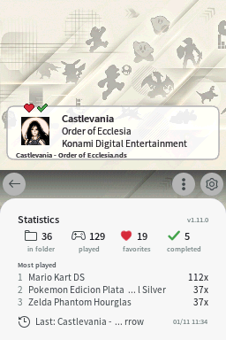
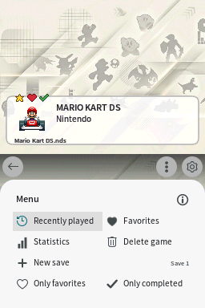
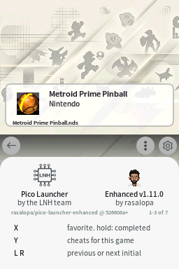

# Pico Launcher Enhanced 简体中文汉化分支

[](../../releases/latest)
[](../../releases)
[](LICENSE.txt)

> **汉化分支说明**
>
> 本仓库是 [Pico Launcher Enhanced](https://github.com/rasalopa/pico-launcher-enhanced) 的简体中文汉化分支，主要面向中文用户。
> 启动器界面已经全部汉化，并统一使用点阵字体绘制中文、英文、数字和符号。
> 仓库结构、安装方式和 SD 卡目录均与原版保持兼容。
> 英文说明请见 [README.en.md](README.en.md)。

这是 [LNH 团队](https://github.com/LNH-team) 的 [Pico Launcher](https://github.com/LNH-team/pico-launcher) 增强分支：加入了收藏、游玩统计、最近游玩等现代主机风格功能，同时完全兼容原版 SD 卡目录结构——可直接替换 `_picoboot.nds`，上游原有功能也全部保留。





*截图来自真机，使用启动器自带的截图快捷键（长按 START）保存。*

## 功能特性

原版 Pico Launcher 的所有功能都在（显示模式、游戏*和文件夹*的[自定义图标、横幅与封面](docs/Customization.md)、[主题](docs/Themes.md)、[金手指](docs/Cheats.md)、[文件关联](docs/FileAssociations.md) —— 详见[使用说明](docs/Usage.md)），此外还加入了：

- **从游戏内返回启动器**（可选）—— 配合发布包中的第二个压缩包 Pico Loader Enhanced，在 DS 游戏中按住 L + R + 右 + SELECT 片刻即可返回启动器；详见[安装](#安装)章节
- **用菜单代替一排图标** —— 应用栏保留返回和显示设置，并新增三点按钮；最近游玩、收藏、统计、删除游戏、为高亮的 DS 游戏新建存档以及两个筛选都放在它打开的菜单中，每项都有文字说明
- **关于面板** —— 从菜单标题栏进入：谁做了什么、确切的构建版本及其来源仓库，以及没有独立按键的操作速查表
- **按首字母跳转** —— 在按名称排序的文件夹中，按 L 或 R 跳到下一个首字母；落到的字母会在下屏底部短暂显示
- **游戏数量显示** —— 当前文件夹的游戏数量，显示在统计面板顶部
- **随机启动游戏** —— SELECT + A
- **收藏** —— 在游戏上按 X 收藏，顶栏会显示爱心标记
- **通关标记** —— 长按 X 标记为已通关，顶栏会显示绿色对勾
- **收藏与通关筛选** —— 菜单中的“仅收藏”和“仅通关”，开启时名称和图标显示为红色或绿色
- **收藏面板** —— 从菜单查看所有文件夹中的收藏游戏；点击条目即可跳转
- **最近游玩面板** —— 从菜单进入；点击条目即可跳转到对应游戏
- **统计面板** —— 从菜单查看总数、最常启动的游戏及其游玩时长和启动器版本
- **截图** —— 长按 START 约半秒，将上下屏幕保存到 `/_pico/screenshots`
- **单游戏启动记录** —— 按游戏记录启动次数和最近游玩日期；最近游玩面板显示每个游戏的日期，统计面板显示启动次数最多的三个游戏；可在 `settings.json` 中关闭
- **游玩时长** —— 由 Pico Loader Enhanced 在游戏运行时实测：收藏面板和统计面板显示每个游戏的时长，统计面板还显示总时长
- **删除游戏** —— 从菜单操作，需确认；删除 ROM，DS 与 GBA 游戏的存档一并删除，DS 游戏的额外存档也会删除
- **模拟器打开的 ROM 也算游戏** —— 通过文件关联由模拟器启动的 GB、SNES 或任意 ROM 都可以标记、删除和随机启动；详见[文件关联](docs/FileAssociations.md)
- **删除主题** —— 从主题选择器操作，需确认；正在使用的主题和启动器自带的两款主题不会被删除
- **saves 存档文件夹** —— 在 `settings.json` 中设置 `"saveLocation": "saves"`，DS 存档就会放在游戏旁的 `saves` 文件夹中，与 TWiLight Menu++ 的目录布局一致，两个启动器可以共用一张卡；详见[使用说明](docs/Usage.md#settings)
- **多存档位** —— 每个 DS 游戏最多可有 9 个额外存档（`.sav1` 到 `.sav9`，TWiLight Menu++ 的命名）；有额外存档的游戏按 A 可挑选要启动的存档，菜单中的“新建存档”可以让游戏在一个新存档上启动；详见[多存档位](docs/Enhanced.md#save-slots)
- **游戏语言** —— 在菜单中把高亮的 DS 游戏切到该地区的下一种语言，随时可以切回“主机”；需要比 v1.0.1 更新的 Pico Loader Enhanced，详见[游戏语言](docs/Enhanced.md#game-language)
- **亮度控制** —— 在显示设置中调节 DS Lite 背光亮度
- **隐藏空文件夹** —— 可选；没有可玩内容的文件夹不会显示在列表中
- **更好用的金手指列表** —— 列表首尾可循环，按 X 可一键关闭全部金手指
- **顶屏游戏标记** —— 金星表示最常启动的游戏，爱心表示已收藏，对勾表示已通关，都绘制在游戏图标上方；[自定义主题](docs/Themes.md)可以移动或隐藏它们
- **文件夹背景音乐** —— 将 `bgm.bcstm` 放入文件夹即可
- **时段主题背景** —— 可选夜间背景，在 20:00 至 6:59 之间显示
- **按文件保存游戏数据** —— 收藏、通关标记和统计属于 ROM 文件本身，两个同名游戏副本不会互相共享

每个功能的详细说明见[增强功能文档](docs/Enhanced.md)。

## 汉化与点阵字体

启动器界面已汉化为简体中文。界面中显示的所有字符——中文、英文、数字和标点——都来自同一套 9pt 文泉驿点阵宋体，并已转换为 Nitro Font 2 格式，存放于 `arm9/data/BitmapSong-9pt.nft2`。转换脚本为 `tools/make_chinese_bitmap_font.py`；字体采用 GNU GPL v2 + 字体嵌入例外授权，详见 [`licenses/wqy-bitmap-song.txt`](licenses/wqy-bitmap-song.txt)。

## 安装

1. 从[最新发布](../../releases/latest)下载 `Pico_Launcher_Enhanced.zip`。
2. 从压缩包中取出 `LAUNCHER.nds`，重命名为 `_picoboot.nds`，放到 SD 卡根目录，覆盖原文件。

不需要对 SD 卡做其他改动——原版安装中的主题、封面和 `_pico` 文件夹都可以继续使用。

> [!NOTE]
> 使用 Pico Launcher 时，SD 卡的 `/_pico` 目录中还需要有 Pico Loader 文件（`aplist.bin`、`patchlist.bin`、`savelist.bin`、`picoLoader7.bin` 和 `picoLoader9.bin`）。

在其他烧录卡上（例如 R4 或 DSTT），只要卡能从根目录启动 `_picoboot.nds`（flashcarts.net 的 DSTT 配置就是这样），安装步骤相同。请把为该卡准备的 Pico Loader 文件放在 `/_pico`：LNH 在 [Pico Loader 发布页](https://github.com/LNH-team/pico-loader/releases)为每种卡提供了对应的压缩包。

### 可选：游戏内退出

发布包中还有第二个压缩包 Pico Loader Enhanced：这是 Pico Loader 的一个版本，可以在 DS 游戏中按住 L + R + 右 + SELECT 片刻，直接从游戏返回启动器。要使用它，把它里面的 `picoLoader7.bin` 和 `picoLoader9.bin` 复制到 `/_pico/`，覆盖官方版本即可。这是可选功能，继续使用官方加载器时启动器行为完全不变。它面向 DSpico 构建，在其他烧录卡上请保留该卡对应的加载器。哪些游戏支持该功能、有哪些已知问题，见[发布说明](../../releases/latest)。

## 从源码构建

推荐使用 WSL（Windows Subsystem for Linux）或 MSYS2 来编译本项目。以下步骤假设你已经配置好其中一种环境。

1. 安装 [BlocksDS](https://blocksds.skylyrac.net/docs/setup/)
2. 拉取子模块：`git submodule update --init`

## 编译

1. 运行 `make`

如果没有在本地安装 BlocksDS，也可以使用 Docker 构建（与 CI 使用同一镜像）：

```sh
docker run --rm -v "$PWD":/work -w /work skylyrac/blocksds:slim-v1.16.0 make
```

启动器会生成在仓库根目录，文件名为 `LAUNCHER.nds`。

2. 将 `LAUNCHER.nds` 复制到 SD 卡。
    - 如果使用 DSpico，请重命名为 `_picoboot.nds` 并放到 SD 卡根目录。
3. 将 `_pico` 文件夹复制到 SD 卡根目录。

使用 DSpico 时，最终目录结构如下：
```
.
├── _pico
│   ├── themes
│   │   ├── material
│   │   │   └── theme.json
│   │   └── raspberry
│   │       ├── bannerListCell.bin
│   │       ├── bannerListCellPltt.bin
│   │       ├── bannerListCellSelected.bin
│   │       ├── bannerListCellSelectedPltt.bin
│   │       ├── bottombg.bin
│   │       ├── gridcell.bin
│   │       ├── gridcellPltt.bin
│   │       ├── gridcellSelected.bin
│   │       ├── gridcellSelectedPltt.bin
│   │       ├── scrim.bin
│   │       ├── scrimPltt.bin
│   │       ├── theme.json
│   │       └── topbg.bin
│   ├── aplist.bin
│   ├── savelist.bin
│   ├── picoLoader7.bin
│   └── picoLoader9.bin
└── _picoboot.nds
```
注意：如果想在 DSpico 上运行 DSiWare，还需要额外文件。详见 [Pico Loader](https://github.com/LNH-team/pico-loader) 的说明。

## 附加工具

[`tools/`](tools/) 目录中包含用于准备 SD 卡内容的桌面辅助脚本——封面转换与下载、横幅和图标生成、夜间背景生成等。详见[工具文档](docs/Tools.md)。

## 数据格式

本分支将每个游戏的数据（收藏、启动次数、游玩时长、多存档位与游戏语言）保存在 `/_pico/gamedata.json` 中。每个条目属于一个 ROM 文件——如果收藏或游玩次数没有出现在你预期的位置，[数据存储](docs/Enhanced.md#data-storage) 中的表格解释了原因。文件格式本身记录在[游戏数据](docs/GameData.md)中，供工具作者参考。

## 贡献

欢迎提交问题、建议和 Pull Request——详见 [CONTRIBUTING.md](CONTRIBUTING.md)。

启动器相对 LNH 上游的每一处增强改动都记录在[相对于上游的改动](docs/Upstream.md)中，包含对应提交和涉及的上游文件，便于单独取用。

## 许可证

图标由 [icons8](https://icons8.com/) 提供。

`arm9/data/BitmapSong-9pt.nft2` 中的点阵字体来自文泉驿点阵宋体；详见 [`licenses/wqy-bitmap-song.txt`](licenses/wqy-bitmap-song.txt)。

本项目采用 Zlib 许可证，详见 `LICENSE.txt`。

项目可能还包含其他许可证，详见 `licenses` 目录。

## 贡献者

Pico Launcher，由 LNH 团队制作：

- [@Gericom](https://github.com/Gericom)
- [@XLuma](https://github.com/XLuma)
- [@Dartz150](https://github.com/Dartz150)
- [@lifehackerhansol](https://github.com/lifehackerhansol)

Pico Launcher Enhanced：

- [@rasalopa](https://github.com/rasalopa)，维护本分支
- [@marlooonxdd](https://github.com/marlooonxdd)：合盖休眠（[#23](https://github.com/rasalopa/pico-launcher-enhanced/pull/23)），以及图标按钮选择器的一处修复（[#24](https://github.com/rasalopa/pico-launcher-enhanced/pull/24)）
- [@BigBrainAFK](https://github.com/BigBrainAFK)：DS 游戏多存档位（[#32](https://github.com/rasalopa/pico-launcher-enhanced/pull/32)）

启动器的基础工作全部归功于 LNH 团队——本分支只是在他们出色工作的基础上继续完善。
